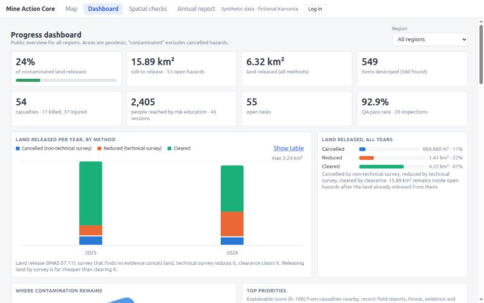
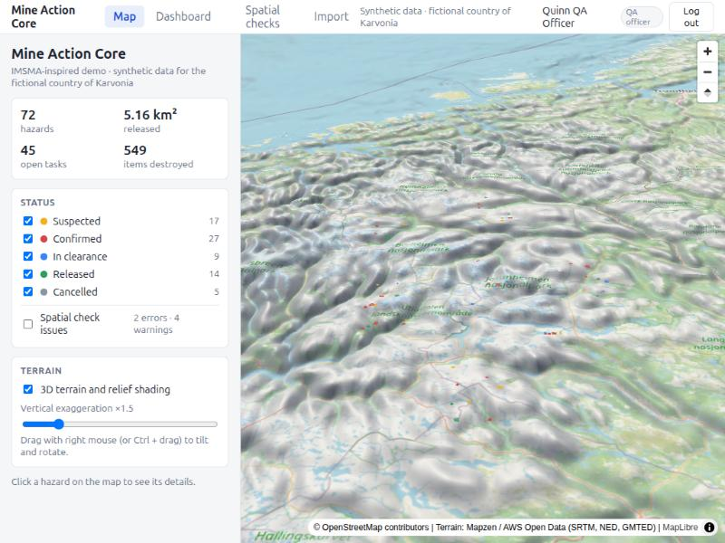
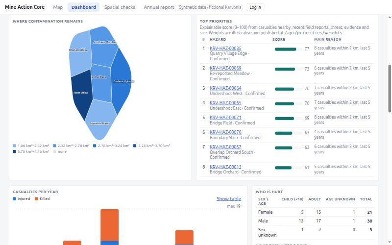
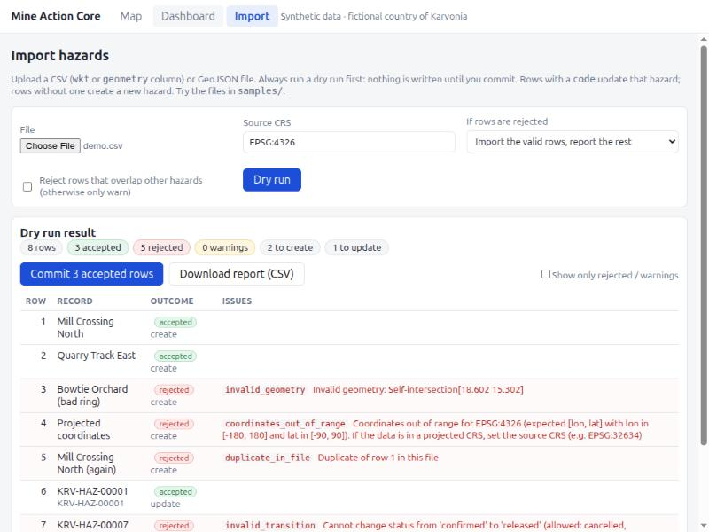
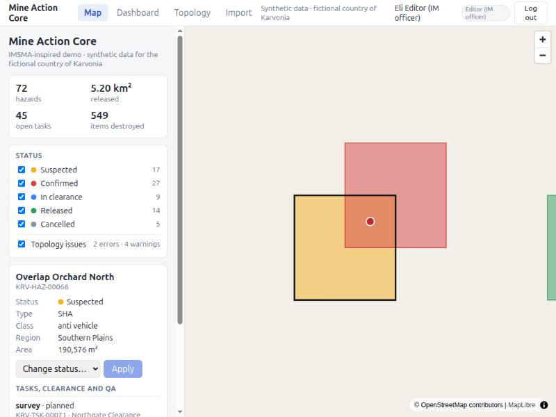
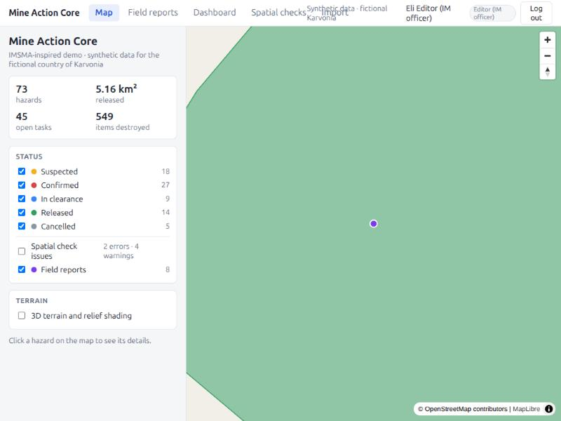
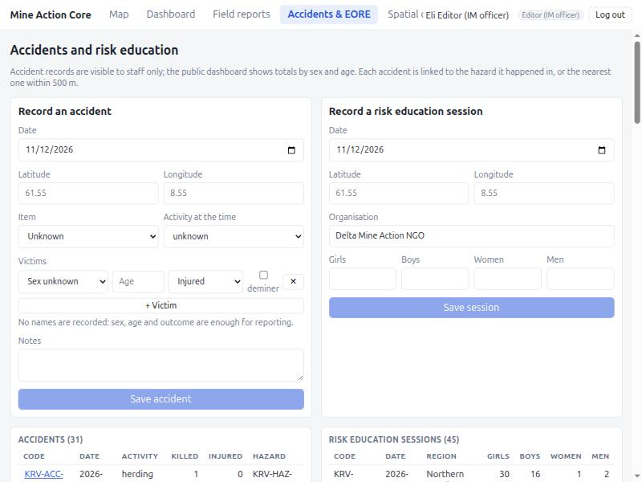
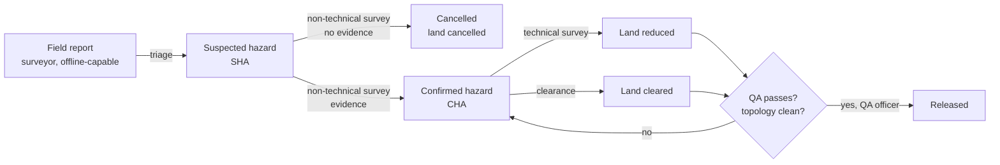
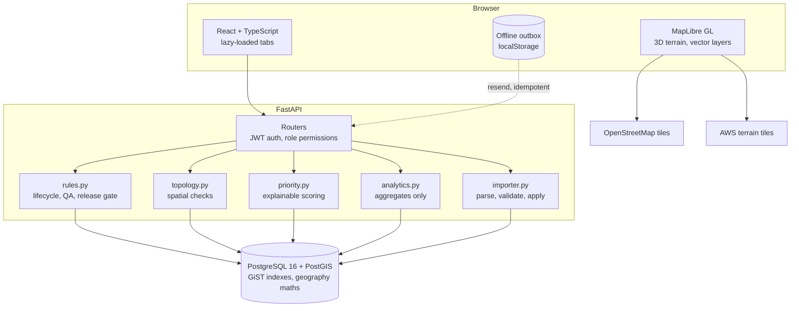

# mine-action-core

[](https://github.com/ThorTveito/mine-action-core/actions/workflows/ci.yml)

**An open-source take on the core ideas of a national mine action information management
system**, inspired by GICHD's IMSMA Core and the International Mine Action Standards (IMAS):
hazardous areas, land release, quality management, field reporting, accidents and victims,
risk education, prioritisation and reporting, built on PostgreSQL/PostGIS, FastAPI and
React + MapLibre.

> Independent portfolio project. Not affiliated with or endorsed by GICHD, and not a copy of
> IMSMA. All data is **synthetic**: the country of Karvonia and every record are fictional.



## Why this project

Information management decides where deminers go next. A mine action IM system has to answer
three questions reliably: *where is the contamination, how much land has been released and how,
and who is being hurt.* This project models that end to end and focuses on the parts that are
easy to get wrong:

- **Land release, not just "clearance"** (IMAS 07.11). Land is *cancelled* by non-technical
  survey, *reduced* by technical survey or *cleared*; the dashboard and annual report keep the
  three apart, because releasing land by survey is far cheaper than clearing it.
- **Data you can trust.** Geometry is validated at the boundary, imports produce a row-by-row
  rejection report, spatial rules catch overlaps and slivers, and a hazard cannot be released
  until QA has passed and its topology is clean.
- **Separation of duties.** Whoever enters or clears data cannot sign it off: release is a
  QA-officer permission.
- **Field data under bad connectivity.** Surveyors report from a phone; reports queue offline
  and resend without duplicates.
- **Privacy by design.** Victims are recorded without names; field reports and accidents are
  staff-only; the public sees aggregates, disaggregated by sex and age.

## What is in it

| Area | What you can do |
|------|-----------------|
| **Map** | Hazards by status on **3D terrain**, administrative boundaries, accidents, field reports and spatial-issue markers; a searchable list of every item sorted by priority |
| **Land release** | Non-technical survey, technical survey and clearance tasks; land-release records whose method follows the task type; per-hazard progress; a hazard can never release more than its area |
| **Quality management** | QA/QC inspections on technical survey and clearance; release needs a passing latest inspection |
| **Field reports** | Phone-friendly form with GPS, offline outbox, triage into a new suspected area, a link to a hazard, or an accident record |
| **Accidents & victims** | Accidents linked to the nearest hazard, victims by sex, age and outcome (no names), deminer casualties kept separate |
| **Risk education** | EORE sessions with girls / boys / women / men counts |
| **Prioritisation** | Transparent 0–100 score per open hazard (casualties nearby, recent reports, threat, evidence, size) with every component explained |
| **Spatial checks** | Overlaps, release conflicts, near-miss gaps, slivers, spikes, tiny areas, region mismatches; adjacency and contiguous clusters |
| **Gazetteer** | Administrative areas as polygons; hazards, accidents and sessions get their region by point-in-polygon |
| **Import** | CSV (WKT) or GeoJSON, dry run by default, CRS reprojection, duplicate/overlap detection, rejection report |
| **Reporting** | Public dashboard (filterable by region, with a choropleth), annual report laid out like an APMBC Article 7 report, CSV/GeoJSON exports |
| **Audit** | Every change with old and new values, source and actor; private history hidden from the public |
| **Roles** | viewer, surveyor, editor (IM officer), QA officer, admin |

<table>
  <tr>
    <td></td>
    <td></td>
  </tr>
  <tr>
    <td align="center">3D terrain with hazards draped on the relief</td>
    <td align="center">Remaining contamination by area, and explainable priorities</td>
  </tr>
  <tr>
    <td></td>
    <td></td>
  </tr>
  <tr>
    <td align="center">Import dry run with a row-by-row rejection report</td>
    <td align="center">A spatial check flags two overlapping hazards</td>
  </tr>
  <tr>
    <td></td>
    <td></td>
  </tr>
  <tr>
    <td align="center">A field report (purple) inside released land is flagged for investigation</td>
    <td align="center">Accidents (victims without names) and risk education sessions</td>
  </tr>
</table>

## Quick start

Requires Docker with Compose.

```bash
make up      # PostGIS, API and frontend
make seed    # synthetic Karvonia: hazards, tasks, QA, field reports, accidents, EORE, users
```

- App: http://localhost:5173 · API docs (Swagger, with Authorize): http://localhost:8000/docs
- Demo accounts (local only), password `demo-password`, also listed on the login form:

| Account | Role | Try this |
|---------|------|----------|
| `surveyor` | Field surveyor | On a phone-sized window, send a finding, then send one with the network off |
| `editor` | IM officer | Review the field report inbox; add a technical survey task to a hazard and record land released |
| `qa` | QA officer | Record a passing inspection, then release the hazard |
| `viewer` | Viewer | Read-only access |
| `admin` | Admin | Everything, including deletes and users |

## A hazard's life, end to end

This is also an automated test ([`test_lifecycle.py`](backend/tests/test_lifecycle.py)):



## Architecture



The data model is in [docs/data-model.md](docs/data-model.md); how each part maps to IMSMA
and IMAS concepts is in [docs/imsma-concepts.md](docs/imsma-concepts.md).

## Engineering

- **Tests:** 184 backend tests against a real PostGIS (98% coverage, CI floor 90%),
  including a full lifecycle story, permission matrices and spatial edge cases; Vitest unit tests
  for the offline outbox, time-series handling and the permission matrix.
- **Spatial work in the database:** geodesic areas and distances (`geography`), GiST-indexed
  prefilters, `ST_Intersection`/`ST_DWithin`/`ST_Contains`, KNN (`<->`), geodesic buffers,
  Voronoi-based synthetic boundaries, `ST_SimplifyPreserveTopology` for the choropleth.
- **Security:** scrypt password hashing, JWT, role-based permissions with separation of duties,
  login throttling, security headers and a strict Content Security Policy in production,
  spreadsheet formula-injection protection on CSV exports, no personal data in public responses.
- **Delivery:** one production container (API + built frontend), Fly.io example, GitHub Actions
  (lint, format, tests with coverage, frontend tests and build, image build), pre-commit hooks.
- **Decisions are written down:** [docs/adr/](docs/adr/).

```bash
make check   # everything CI runs: lint, format check, backend tests, frontend tests and build
```

## Documentation

| Document | About |
|----------|-------|
| [docs/imsma-concepts.md](docs/imsma-concepts.md) | How the IMSMA Core / IMAS concepts map onto this code |
| [docs/data-model.md](docs/data-model.md) | Entities and relations |
| [docs/topology.md](docs/topology.md) | Spatial checks: rules and thresholds |
| [docs/prioritisation.md](docs/prioritisation.md) | The priority score and its limits |
| [docs/field-reports.md](docs/field-reports.md) | Field reporting, offline outbox, triage |
| [docs/DEPLOY.md](docs/DEPLOY.md) | Deploying the single-container demo |
| [docs/adr/](docs/adr/) | Architecture decision records |
| [docs/glossary.md](docs/glossary.md) | Terms used in the code and UI |
| [AGENTS.md](AGENTS.md) | Conventions for contributors (and coding agents) |

## Limitations and next steps

- Geometry is created by import, field-report triage or the API; there is no polygon drawing
  tool in the browser yet.
- The offline outbox works without a connection, but the app must be opened online once (no
  service worker yet); field reports have no photos yet.
- Login throttling is in memory, per process.
- Spatial checks run on demand over all hazards: fine for thousands of polygons, not millions
  (vector tiles and incremental checks would be next).
- Released land is terminal; re-opening after a later find is a decision made outside the app.
- Prioritisation weights are illustrative, not a national standard.
- The synthetic country sits on real terrain in central Norway so the 3D view has relief; the
  basemap therefore shows real place names. No real mine action data is used anywhere.
