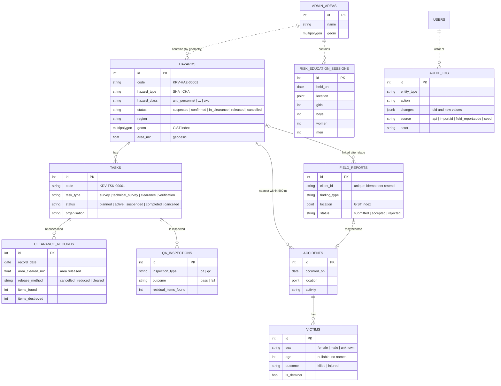

# Data model

PostgreSQL 16 with PostGIS. All geometry is EPSG:4326; areas, lengths and distances are
computed on `geography` (metres). Migrations are hand-written and reversible
([`backend/alembic/versions/`](../backend/alembic/versions/)).

## Integrity rules worth knowing

- Enums are strings with CHECK constraints (simple, reversible migrations).
- A land-release record's method must match its task type; verification releases nothing; the
  land released inside a hazard can never exceed its area (1% tolerance).
- An inspection that found residual items cannot pass (CHECK constraint and API validation).
- `field_reports.client_id` is unique, which makes offline resends idempotent.
- Audit rows are append-only and never cascade-deleted.
